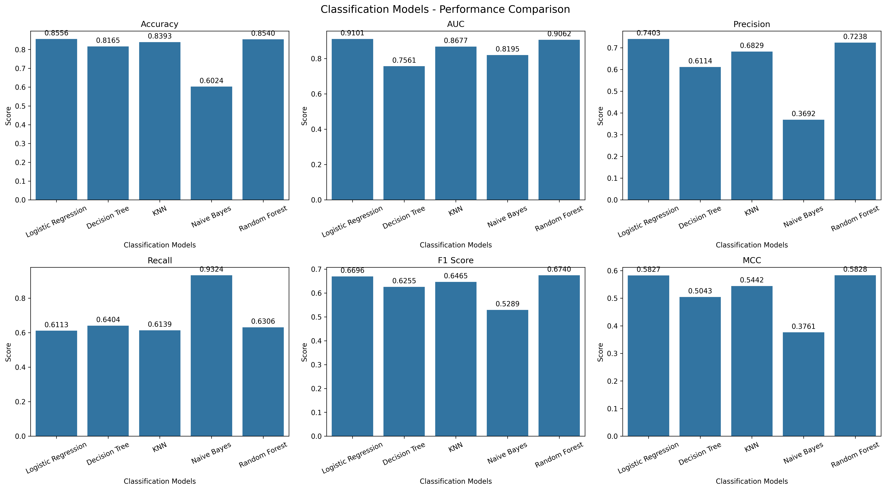
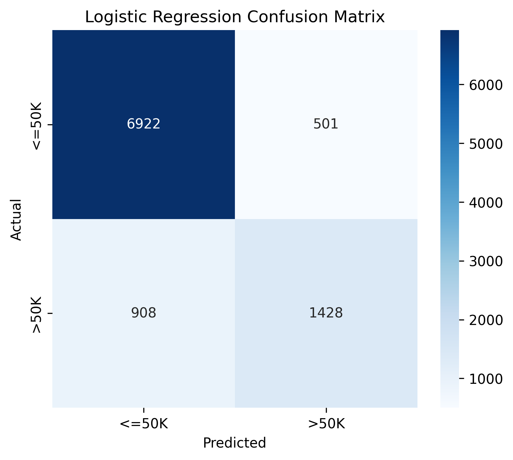
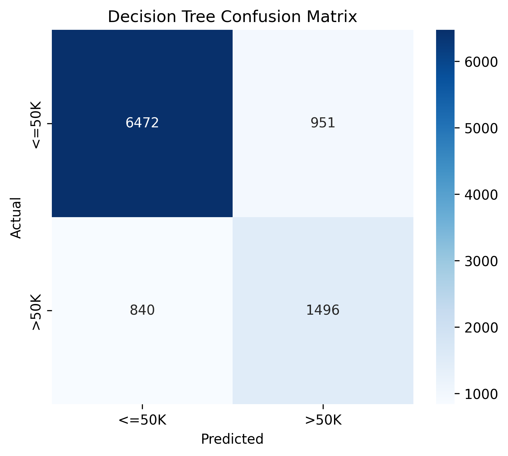
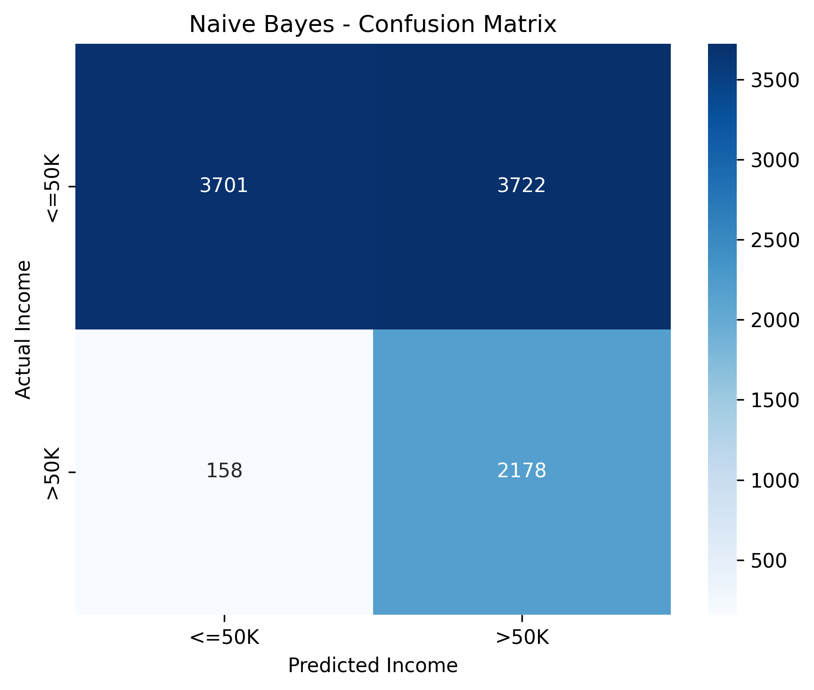
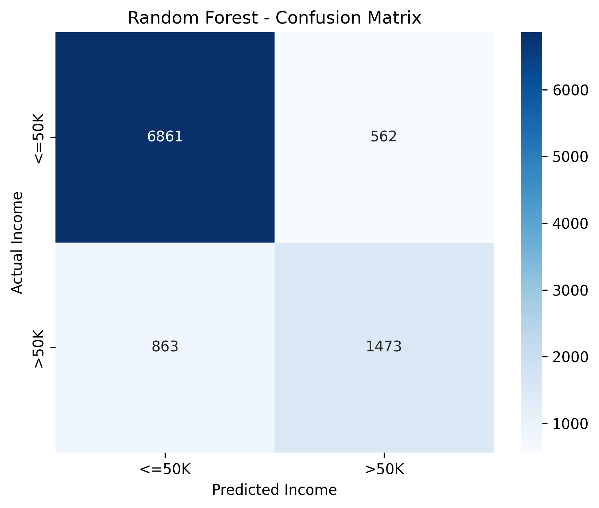

# Adult Income Classification Using Machine Learning

## 1. Problem Statement

The objective of this assignment is to develop and compare five machine learning classification algorithms to predict whether an individual's annual income exceeds $50,000 based on demographic and employment-related attributes.

This is a binary classification problem.

## 2. Dataset Description

Dataset: Adult Census Income Dataset

Source: [UCI Machine Learning Repository](https://archive.ics.uci.edu/dataset/2/adult)

The dataset contains demographic and employment-related information.

- Original records: 48,842
- Records after duplicate removal: 48,794
- Input features: 14
- Target variable: income
- Classification classes: `<=50K` and `>50K`

The dataset contains 6 numerical features and 8 categorical features.

## 3. Data Preprocessing

The following preprocessing operations were performed:

1. Checked and handled missing values.
2. Removed duplicate records.
3. Normalized target labels by removing trailing periods.
4. Encoded the target variable:
   - `<=50K` = 0
   - `>50K` = 1
5. Separated input features and target variable.
6. Split the dataset into 80% training and 20% testing using stratified sampling.
7. Applied median imputation for numerical features.
8. Applied most-frequent imputation for categorical features.
9. Applied StandardScaler to numerical features.
10. Applied OneHotEncoder to categorical features.

Preprocessing was implemented using a Pipeline and ColumnTransformer to prevent data leakage. The preprocessing steps were fitted only on the training data.

## 4. Class Distribution

After duplicate removal:

- `<=50K`: 37,113 records (76.06%)
- `>50K`: 11,681 records (23.94%)

The dataset is imbalanced, with `<=50K` as the majority class. Therefore, multiple evaluation metrics were considered instead of relying only on accuracy.

## 5. Classification Models

The following five classification algorithms were implemented:

1. Logistic Regression
2. Decision Tree
3. K-Nearest Neighbors (KNN)
4. Gaussian Naive Bayes
5. Random Forest

All models were trained using the same preprocessing pipeline and training dataset.

## 6. Model Evaluation

The models were evaluated using the following metrics:

- Accuracy
- AUC
- Precision
- Recall
- F1 Score
- Matthews Correlation Coefficient (MCC)

Precision, Recall and F1 Score were calculated considering `>50K` as the positive class.

### Performance Comparison

| Model | Accuracy | AUC | Precision | Recall | F1 Score | MCC |
|---|---:|---:|---:|---:|---:|---:|
| Logistic Regression | 0.8556 | 0.9101 | 0.7403 | 0.6113 | 0.6696 | 0.5827 |
| Decision Tree | 0.8165 | 0.7561 | 0.6114 | 0.6404 | 0.6255 | 0.5043 |
| KNN | 0.8393 | 0.8677 | 0.6829 | 0.6139 | 0.6465 | 0.5442 |
| Naive Bayes | 0.6024 | 0.8195 | 0.3692 | 0.9324 | 0.5289 | 0.3761 |
| Random Forest | 0.8540 | 0.9062 | 0.7238 | 0.6306 | 0.6740 | 0.5828 |

### Graphical Representation of All Six Metrics

The following graph compares all five classification models using the six evaluation metrics: Accuracy, AUC, Precision, Recall, F1 Score and MCC.



## 7. Model Observations

### Logistic Regression

Achieved the highest Accuracy (85.56%) and AUC (0.9101), demonstrating strong overall classification performance. It also achieved the highest Precision of 0.7403.

### Decision Tree

Achieved an Accuracy of 81.65% and AUC of 0.7561. Its performance was lower than the leading models on most evaluation metrics.

### K-Nearest Neighbors

Achieved an Accuracy of 83.93% and AUC of 0.8677, showing reasonable classification performance.

### Gaussian Naive Bayes

Achieved the highest Recall (93.24%), correctly identifying a large proportion of actual `>50K` cases. However, its Precision was 36.92%, indicating a high number of false positive predictions.

### Random Forest

Achieved the highest F1 Score (0.6740) and MCC (0.5828), indicating a good balance between Precision and Recall and strong overall classification performance.

## 8. Confusion Matrix Analysis

The confusion matrices were generated for all five models to examine True Positives, True Negatives, False Positives and False Negatives.

| Model | TN | FP | FN | TP |
|---|---:|---:|---:|---:|
| Logistic Regression | 6922 | 501 | 908 | 1428 |
| Decision Tree | 6472 | 951 | 840 | 1496 |
| KNN | 6757 | 666 | 902 | 1434 |
| Naive Bayes | 3701 | 3722 | 158 | 2178 |
| Random Forest | 6861 | 562 | 863 | 1473 |

### Confusion Matrix Visualizations

#### Logistic Regression



#### Decision Tree



#### KNN


#### Naive Bayes



#### Random Forest



Naive Bayes identified the largest number of actual `>50K` cases but also generated the highest number of false positives.

## 9. Overall Winner for the Dataset

Based on the evaluation results, **Random Forest is selected as the overall best-performing model** for the Adult Income Classification dataset.

- F1 Score: 0.6740 (Highest among the five models)
- MCC: 0.5828 (Highest among the five models)
- Accuracy: 0.8540
- AUC: 0.9062

Random Forest demonstrated a good balance between Precision and Recall and achieved the highest F1 Score and MCC.

Logistic Regression also demonstrated competitive performance, achieving the highest Accuracy of 0.8556 and AUC of 0.9101.

The MCC values of Random Forest (0.5828) and Logistic Regression (0.5827) are nearly identical. Therefore, both models demonstrated comparable overall performance.

Considering the F1 Score and MCC, **Random Forest is selected as the overall winner for this dataset.**

## 10. Repository Structure

```text
Adult-Income-Classification/
|
|-- model/
|   |-- logistic_regression.joblib
|   |-- decision_tree.joblib
|   |-- knn.joblib
|   |-- naive_bayes.joblib
|   |-- random_forest.joblib
|
|-- images/
|   |-- model_performance_comparison.png
|   |-- logistic_regression_confusion_matrix.png
|   |-- decision_tree_confusion_matrix.png
|   |-- knn_confusion_matrix.png
|   |-- naive_bayes_confusion_matrix.png
|   |-- random_forest_confusion_matrix.png
|
|-- adult_income_classification.ipynb
|-- adult_income_dataset.csv
|-- test_data.csv
|-- requirements.txt
|-- README.md
```

## 11. Conclusion

This assignment implemented and evaluated five machine learning classification algorithms on the Adult Census Income dataset.

Random Forest achieved the highest F1 Score and MCC, while Logistic Regression achieved the highest Accuracy and AUC. The results demonstrate that different classification algorithms perform differently across evaluation metrics, particularly when working with an imbalanced dataset.

The assignment highlights the importance of appropriate preprocessing, stratified sampling, and comprehensive model evaluation.
